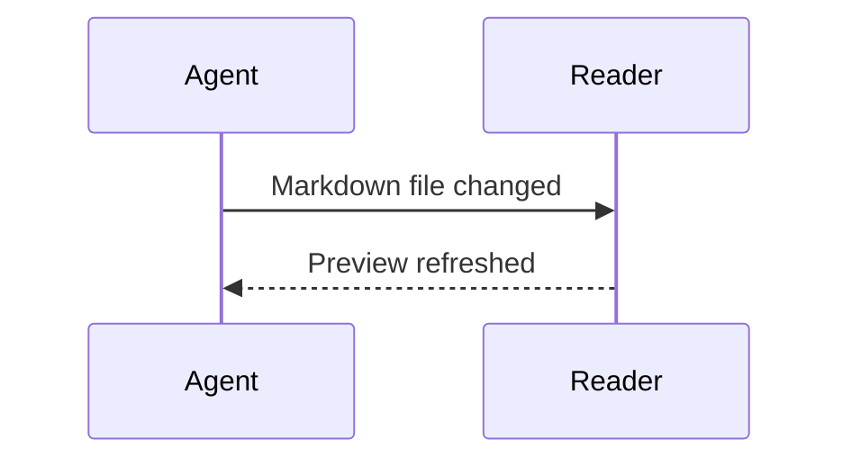

# tpreview

Read Markdown and Mermaid in the terminal you already use. Keep a preview beside your editor or coding agent, locally or over SSH.

```sh
tpreview --watch docs/design.md
```

`tpreview` is a native Rust CLI/TUI for macOS and Linux. The application needs **no Node.js, Python, browser, Mermaid CLI, server, or API key**. Mermaid parsing, layout, text rendering and PNG generation are included in the executable. Documents work offline.

This is an early release. **Flowcharts and sequence diagrams** are the supported Mermaid families. Text rendering is the safe default in tmux. Direct Kitty-compatible image rendering is implemented and protocol-tested; actual Ghostty/Kitty display and SSH image transport still require manual validation. See the [compatibility and test record](docs/verification.md).

## Install

Install the latest release with either **curl** or **wget**. The installer detects macOS/Linux and ARM64/x86_64, downloads the matching bundle, verifies SHA-256, checks the executable version, and installs to `~/.local/bin`. No Rust toolchain or sudo is needed.

**curl**

```sh
curl -fsSL https://github.com/affisto/tpreview/releases/latest/download/install.sh | sh -s -- --downloader curl
```

**wget**

```sh
wget -qO- https://github.com/affisto/tpreview/releases/latest/download/install.sh | sh -s -- --downloader wget
```

If `~/.local/bin` is not on your PATH, add it in your shell configuration:

```sh
export PATH="$HOME/.local/bin:$PATH"
tpreview --version
tpreview --watch README.md
```

Choose an install directory or pin a version:

```sh
curl -fsSL https://github.com/affisto/tpreview/releases/download/v0.1.2/install.sh | sh -s -- --bin-dir "$HOME/bin"
# An installer can also select a specific compatible release:
curl -fsSL https://github.com/affisto/tpreview/releases/latest/download/install.sh | sh -s -- --version v0.1.2
```

`TPREVIEW_INSTALL_DIR`, `TPREVIEW_VERSION` and `TPREVIEW_DOWNLOADER` are equivalent environment options for the installer. Run `sh install.sh --help` after downloading the script for all options. The script never edits shell profiles, uses sudo or removes macOS quarantine settings. Failed downloads/checksums/version checks leave an existing executable intact. Re-running installs/upgrades the selected version.

The script from each release defaults to that exact version, so a moving `latest` URL cannot mix bundles and checksums from different releases. `latest` selects the latest non-prerelease; to install an RC, use its explicit `/releases/download/vX.Y.Z-rc.1/install.sh` URL.

### Download a bundle directly

[GitHub Releases](https://github.com/affisto/tpreview/releases/latest) contains four native bundles:

| Platform | Bundle |
| --- | --- |
| macOS Apple Silicon | `tpreview-aarch64-apple-darwin.tar.gz` |
| macOS Intel | `tpreview-x86_64-apple-darwin.tar.gz` |
| Linux ARM64 (glibc) | `tpreview-aarch64-unknown-linux-gnu.tar.gz` |
| Linux x86_64 (glibc) | `tpreview-x86_64-unknown-linux-gnu.tar.gz` |

Each bundle includes `tpreview`, `VERSION`, the installer, README, documentation and license notices. Only the executable is needed at runtime. The release includes adjacent `.sha256` files, `install.sh` and `SHA256SUMS`. The installer uses `tar` and either `sha256sum` or `shasum`, standard on the tested Linux/macOS systems. Linux bundles are built on Ubuntu 24.04 and require glibc; Alpine/musl needs a source build. macOS binaries are not notarized.

For example, download the Linux x86_64 bundle with curl **or** wget:

```sh
curl -fLO https://github.com/affisto/tpreview/releases/latest/download/tpreview-x86_64-unknown-linux-gnu.tar.gz
# or
wget https://github.com/affisto/tpreview/releases/latest/download/tpreview-x86_64-unknown-linux-gnu.tar.gz
```

Download the adjacent `.sha256` URL, run `sha256sum -c filename.tar.gz.sha256` (Linux) or `shasum -a 256 -c filename.tar.gz.sha256` (macOS), extract the archive, and copy `tpreview` to your PATH. Checksums detect corrupted/mismatched downloads; they are not a separate signing key.

### Build from source

Or build from source with Rust **1.92 or later** and the platform's normal compiler/linker:

```sh
git clone https://github.com/affisto/tpreview.git
cd tpreview
cargo install --locked --path .
```

First build downloads Rust crates. Once dependencies are cached, `cargo build --locked --offline --release` works offline. Runtime never downloads anything. No Homebrew formula or crates.io publication is claimed.

## Use

```sh
tpreview README.md
tpreview ./docs
tpreview --watch docs/design.md
cat README.md | tpreview -
tpreview --render auto README.md
tpreview --render text README.md
tpreview --render image README.md
tpreview --doctor
```

- A directory opens the file panel and its first Markdown document. `f` refreshes and focuses that panel; press it again while focused to close it. Click a file or use `j/k` and Enter to open it.
- `--watch` watches the current file, debounces 180 ms, handles atomic saves, and reconciles every second if filesystem events are lost. Other files never steal the current view.
- `auto` queries the controlling terminal for Kitty graphics and cell size, with a 350 ms deadline. Terminal names alone never enable images. Unknown terminals, tmux, screen, and failed probes use text.
- `image` requests images but retains the same capability checks; it safely falls back to text with an explanation. Sixel and iTerm2 image protocols are not implemented.
- Piped input still supports keyboard interaction through `/dev/tty` when available. Redirected stdout or no controlling terminal produces readable, escape-free text and exits; watch is not an endless stream in this mode.
- `--doctor` reports TTY/tmux state, selected backend, probe failure, cell metrics, font inventory and known limits. Redirected doctor output sends no terminal queries.

The executable name is **tpreview**; the initial working name `mdview` is not installed as an alias.

## Read and navigate

Headings, paragraphs, nested lists, tasks, block quotes, fenced code, syntax highlighting, tables, links, rules and Mermaid blocks are displayed. Prose reflows at the current width. Code, tables and text diagrams preserve their columns and scroll horizontally. Korean, Japanese and combining/emoji graphemes use Unicode display widths.

| Key | Action |
| --- | --- |
| `j` / `k`, ↓ / ↑ | Scroll; move selection while a panel has focus |
| PageDown / PageUp, Space | Page down / up; Space moves down |
| `g` / `G` | First / last page |
| `h` / `l`, ← / → | Horizontal pan for wide blocks |
| `/`, Enter, Esc | Type a search, jump to a match, close search input |
| `n` / `N` | Next / previous match, wrapping at the end |
| Tab / Shift+Tab | Select next / previous link or diagram |
| Enter | Open selection; if none, open the first visible actionable item |
| `b`, Backspace | Return to previous document and reading position |
| `f` / `t` | Focus or close files / heading contents; `j/k`, Enter or `l` select |
| Click / mouse wheel | Open a file or link / scroll the pointed panel or document |
| Esc | Close panel, selection and search highlighting |
| `r` | Reload |
| `?` | Complete, scrollable keyboard guide |
| `q`, Ctrl+C | Quit; `q` first closes an open guide/detail |

In a diagram detail view, `+` / `-` zoom **images**, `0` resets, arrows or `h/j/k/l` pan, and PageUp/Down move vertically. Text diagrams pan without geometric zoom. Esc returns to the document. Below 60 columns, navigation panels replace the reading area while focused and reveal the document after selection. Hold Shift while dragging to use terminal text selection.

Click a link or select it with Tab and press Enter. HTTP/HTTPS URLs open in the default browser using macOS `open` or Linux `xdg-open` on the running host. Relative and absolute file paths (including local `file:///` URLs) open inside the TUI; Markdown is rendered and other UTF-8 text files show their literal source. `#heading` fragments jump to headings, including links to another document. `b` returns to the previous reading position. For stdin, relative links resolve from the current working directory. Search is a case-insensitive literal search of rendered lines; image diagrams are also searchable by their Mermaid source. A phrase split across wrapped rows is not matched as one phrase.

YAML (`---`) and TOML (`+++`) frontmatter appears in a separate, literal metadata block. Multiline values and comments remain readable and do not become document headings or links.

## Mermaid and editing




Unchanged diagrams reuse an in-memory cache. During incomplete edits, an earlier successful diagram remains visible with **“이전 정상 결과 표시 중 / previous valid result”**, the current error and source. New invalid diagrams show their source and reason. No unsupported statement is silently accepted when the engine reports a warning.

Reading position follows an unchanged block, then its heading/block identity when possible. The renderer runs in a disposable copy of this same executable, off the UI thread. Each result carries a document generation and source identity; obsolete work is killed and cannot overwrite newer text.

See [supported syntax and limits](docs/mermaid.md), [technical decisions](docs/decisions.md), and [tests/manual checks](docs/verification.md).

## Fonts and images

Noto Sans is embedded under the SIL Open Font License. Diagram rasterization also reads local system fonts; CJK image labels need a suitable local font. macOS CJK output was visually checked. Minimal Linux installations may need a CJK font such as Noto Sans CJK, or an explicit local file:

```sh
tpreview --font /path/to/NotoSansCJK-Regular.otf examples/next.md
```

Text mode uses your terminal's font. Font name/glyph coverage cannot be reliably queried from the terminal. Emoji and ambiguous-width characters may differ with terminal settings. The renderer does not automatically install fonts.

Images are clipped to the visible document region, and owned image IDs are deleted before redraw and on exit. tmux passthrough alone does not establish reliable pane clipping, so this release deliberately uses text inside tmux, even with `--render image`; it never edits your tmux settings.

## Development

### VS Code visual editor

The optional [MD Visual Editor extension](extensions/vscode/README.md) adds WYSIWYG Markdown editing, task lists, tables, and offline Mermaid previews. It saves ordinary Markdown files through VS Code and runs independently of the Rust CLI. See the [한국어 사용 가이드](docs/vscode-usage.ko.md) for screenshots and a captioned walkthrough.

[Watch the 44-second walkthrough](https://github.com/affisto/tpreview/releases/download/extension-v0.1.1/md-visual-editor-walkthrough.mp4) · [More screenshots and features](extensions/vscode/README.md#screenshots)

[](https://github.com/affisto/tpreview/releases/download/extension-v0.1.1/md-visual-editor-walkthrough.mp4)

**Install on another computer:** download the [VSIX package](https://github.com/affisto/tpreview/releases/download/extension-v0.1.4/tpreview-markdown-0.1.4.vsix), then use **Extensions → … → Install from VSIX…** in VS Code. No Node.js or Rust installation is needed. To build it yourself:

```sh
cd extensions/vscode
npm ci
npm run package
code --install-extension ../../dist/tpreview-markdown-0.1.4.vsix
```

Then run **MD Visual Editor: Open Visual Markdown Editor** for a Markdown file. See the extension README for source-preservation limits and testing instructions. VSIX downloads are available through GitHub Releases.

### Terminal application

```sh
cargo run -- --watch examples/demo.md
cargo run -- --render text examples/errors.md
cargo run --example probe
cargo run --example terminal_probe
cargo fmt --all --check
cargo clippy --locked --all-targets -- -D warnings
cargo test --locked --all-targets
cargo build --locked --release
python3 scripts/pty_smoke.py
python3 scripts/tmux_smoke.py
```

Python 3.11+ and tmux are **development/test-only** dependencies. Installer and packaging tests run with `python3 scripts/test_install.py`. Maintainers can follow the [automated release procedure](docs/releasing.md). `terminal_probe` exits after a key or five seconds. Unit/integration tests cover Unicode, parser errors, controls, navigation, caching, stale results, PNG generation and non-TTY behavior. PTY tests exercise real terminal input and restoration, and simulate Kitty capability replies. The isolated tmux test uses a separate socket and `/dev/null` config.

Modules separate CLI (`cli`), source loading (`source`), Markdown (`document`), Mermaid (`mermaid`, `worker`), capabilities/input (`terminal`), image transport (`graphics`), wrapping (`layout`), application state (`app`), drawing (`ui`), and watching (`watch`).

No document command is executed. No remote resource is fetched. Control characters are neutralized. Limits and remaining fidelity tradeoffs are documented rather than hidden.

## License

MIT. The embedded font uses SIL OFL 1.1; see [assets/OFL.txt](assets/OFL.txt). Dependency notices accompany distribution archives.
