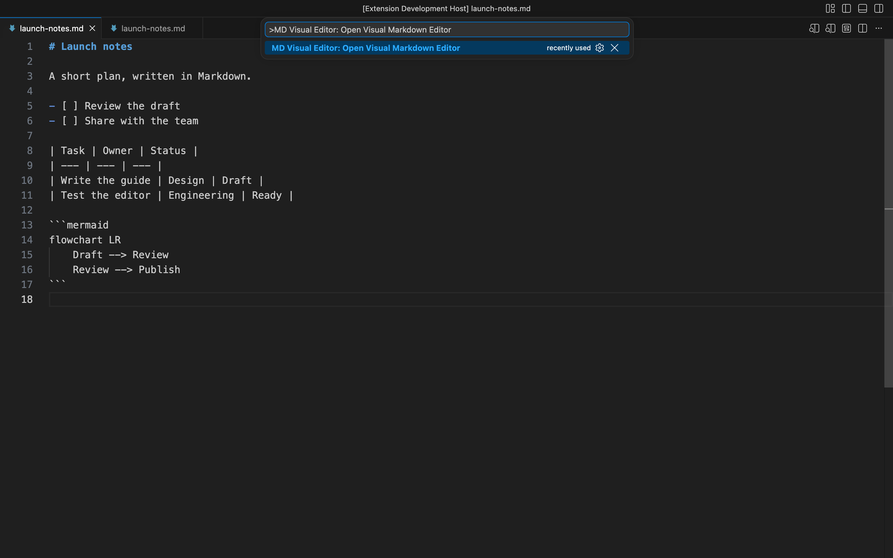
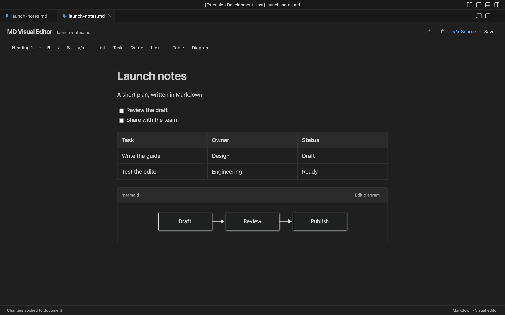
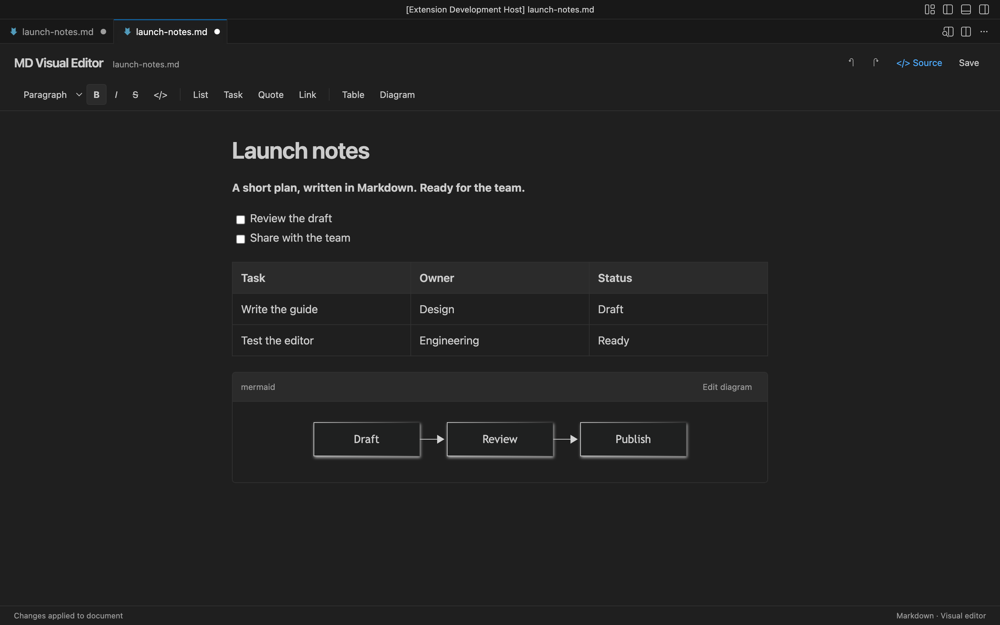
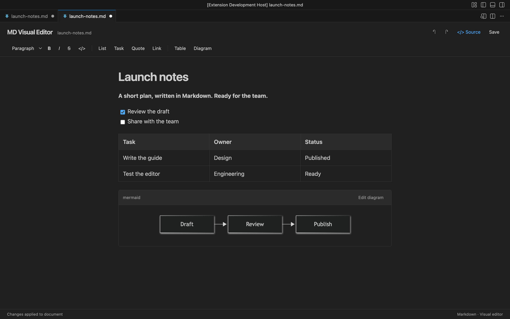
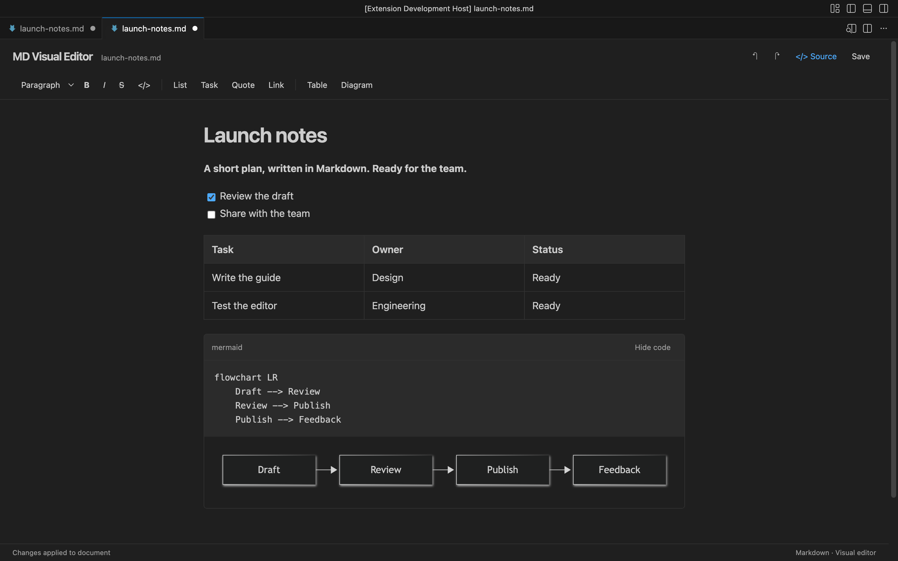
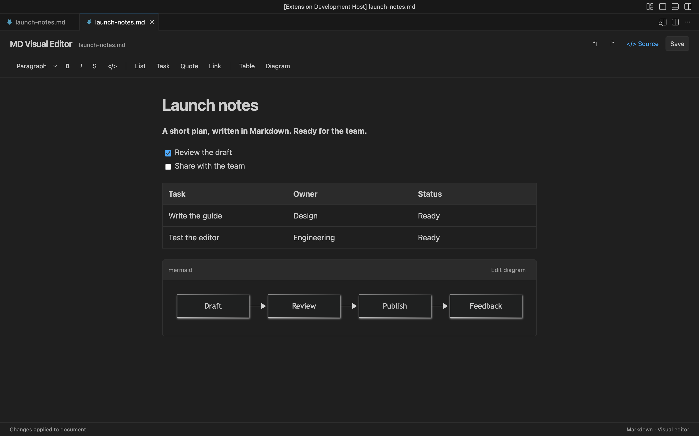
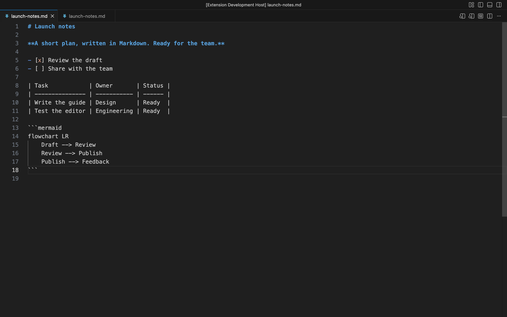

# MD Visual Editor 사용 가이드

Markdown 파일을 렌더링된 화면에서 직접 편집하는 VS Code 확장입니다. 글, 체크리스트, 표를 수정하고 Mermaid 다이어그램을 확인한 뒤 같은 `.md` 파일에 저장할 수 있습니다.

[한국어 자막 사용 영상 보기 / 다운로드](https://github.com/affisto/tpreview/releases/download/extension-v0.1.1/md-visual-editor-walkthrough.mp4) · [스크린샷·영상·자막 전체 다운로드](https://github.com/affisto/tpreview/releases/download/extension-v0.1.1/md-visual-editor-media.zip)

이 가이드의 화면과 영상은 예제 문서 `launch-notes.md`를 실제 VS Code에서 편집하며 촬영했습니다. 영상에는 한국어 자막이 있으며 음성은 없습니다.

## 1. 설치하고 편집기 열기

1. [VSIX 설치 파일](https://github.com/affisto/tpreview/releases/download/extension-v0.1.4/tpreview-markdown-0.1.4.vsix)을 내려받습니다.
2. VS Code의 확장 화면에서 **⋯ → Install from VSIX…**를 선택하고 파일을 설치합니다.
3. 편집할 `.md` 파일을 엽니다.
4. Mac은 **⌘ Shift P**, Windows/Linux는 **Ctrl Shift P**로 명령 팔레트를 열고 **MD Visual Editor: Open Visual Markdown Editor**를 실행합니다.

VS Code 1.96 이상이 필요합니다. 확장을 사용하기 위해 Node.js나 Rust를 설치할 필요는 없습니다. 기존 설치와의 호환성을 위해 확장 ID와 설치 파일 이름에는 `tpreview-markdown`을 유지합니다.

## 2. 렌더링된 문서에서 바로 편집하기

문장을 클릭해 커서를 놓고 입력합니다. 제목, 목록, 표, 다이어그램은 화면에 렌더링된 형태로 표시됩니다.

글자를 선택한 뒤 도구 모음의 **B**나 **I**를 눌러 서식을 적용합니다. **Paragraph** 선택 메뉴에서는 제목 수준을 바꿀 수 있습니다. **List**, **Quote**, **Link**로 목록·인용·링크를 추가합니다.

## 3. 체크리스트와 표 수정하기

체크박스를 클릭하면 완료 여부가 변경됩니다. **Task**는 새 체크리스트 항목을, **Table**은 새 표를 추가합니다. 표의 셀을 클릭해 내용을 수정하고 Tab으로 다음 셀로 이동할 수 있습니다.

## 4. Mermaid 다이어그램 편집하기

기존 Mermaid 코드 블록은 다이어그램으로 표시됩니다. 새 다이어그램은 **Diagram** 버튼으로 추가합니다.

**Edit diagram**을 누르면 코드를 수정할 수 있습니다. 코드가 바뀌면 미리보기가 갱신됩니다. 문법이 불완전한 동안에는 마지막으로 정상 렌더링된 결과와 오류 안내가 표시됩니다.

**Hide code**를 누르면 코드를 접고 다이어그램만 확인할 수 있습니다.

## 5. 저장하고 원문 확인하기

**Save** 또는 **⌘ S / Ctrl S**를 누르면 원래 `.md` 파일에 저장합니다. 위쪽 실행 취소·다시 실행 버튼도 VS Code 문서 변경 내역과 연결됩니다.

**Source**는 일반 VS Code 소스 편집기로 전환합니다. 다시 시각적 편집 화면으로 돌아오려면 명령 팔레트에서 MD Visual Editor 명령을 실행합니다.

항상 이 편집기로 열려면 파일 탭을 우클릭하고 **Reopen Editor With… → Configure default editor → MD Visual Editor**를 선택합니다.

## 알아둘 점

- 수정하지 않은 최상위 블록의 원문 표기는 유지합니다. 수정한 목록이나 표 전체는 Markdown 출력 형식이 정리될 수 있습니다.
- YAML frontmatter는 본문 위의 내장 YAML 편집기에서 직접 수정합니다. 구문 강조, 줄 번호, Tab 들여쓰기, 오류 표시를 제공하며 **Save**·**Undo/Redo**가 본문과 함께 적용됩니다. 주석·구분자·줄바꿈과 본문 원문은 유지합니다. 메타데이터가 없으면 **Add YAML frontmatter**로 추가할 수 있습니다.
- YAML 편집기에는 필드만 입력합니다. `---` 구분자는 자동으로 관리합니다. TOML 메타데이터는 **Open metadata source**에서 수정합니다.
- Mermaid의 **− / +**로 축소·확대하고, 배율 버튼으로 **100%**, **Fit**으로 화면 너비에 맞춥니다. ⌘/Ctrl+휠 확대와 드래그 이동도 지원합니다. 확대·축소는 파일 내용을 바꾸지 않습니다.
- 링크를 클릭하면 HTTP/HTTPS는 브라우저로, 상대·절대 Markdown 경로는 시각 편집기로 이동합니다. `#제목` 앵커도 지원합니다. 링크 글자를 편집할 때는 Alt-click을 사용합니다.
- HTML, 각주, 닫히지 않은 frontmatter 등 안전하게 왕복 변환할 수 없는 문법은 원문 편집으로 안내합니다.
- 외부 수정과 충돌하면 작성 중인 내용을 보관합니다. **Copy my draft**로 복사한 뒤 **Use file version**으로 파일 내용을 불러옵니다.
- 상태 표시의 `Changes applied to document`는 문서에 수정 내용이 반영됐다는 뜻입니다. 디스크 저장은 Save로 실행합니다.
