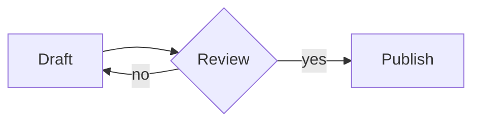
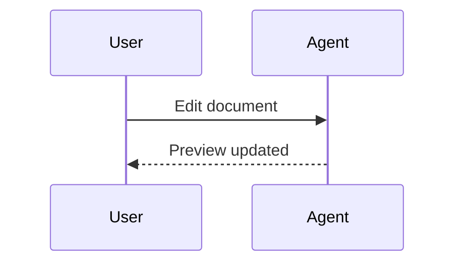

# tpreview · 터미널 문서 읽기

Markdown과 Mermaid를 같은 터미널에서 읽습니다. 日本語も表示できます。

## Flowchart



## Sequence



## Reading tools

- [x] Offline Markdown and Mermaid
- [x] 한글과 日本語 display width
- [ ] Verify your terminal with `tpreview --doctor`

> Keep this pane open while your agent edits the file.
> Press `/` to search for **Preview**, then `n` or `N`.

[Open the next document](next.md#돌아가기) · [Jump to flowchart](#flowchart)

### Code and wide tables

```rust
fn main() {
    println!("안녕하세요 · こんにちは · a long line remains intact; use the left and right arrow keys to pan horizontally");
}
```

| 언어 / 言語 | Message | Long description |
| :--- | :--- | :--- |
| 한국어 | 안녕하세요 | This intentionally wide column demonstrates horizontal scrolling without losing table alignment. |
| 日本語 | こんにちは | Resize the terminal and use h/l or the left/right arrows. |

---

No commands in this document run. Remote links and images are never fetched.
