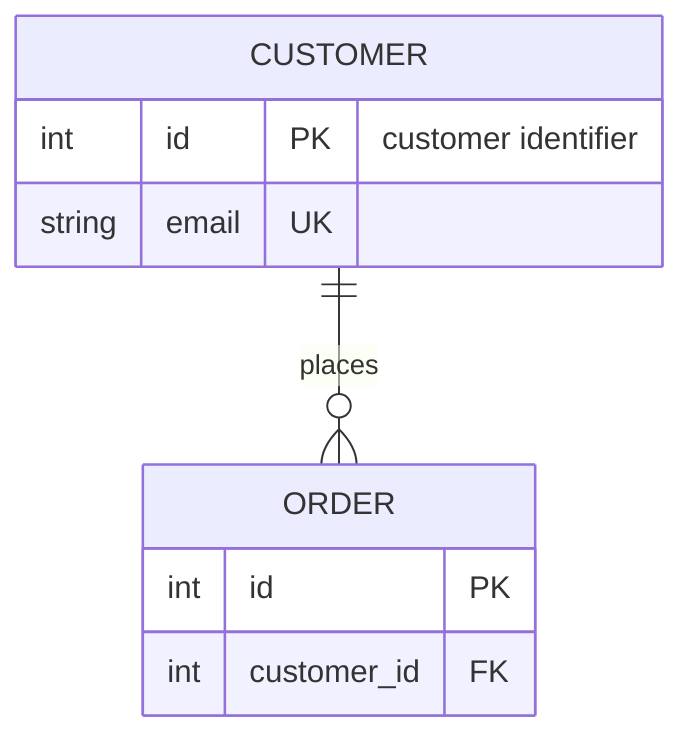
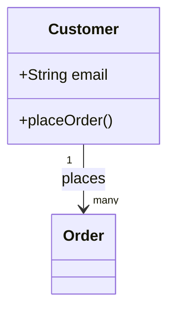
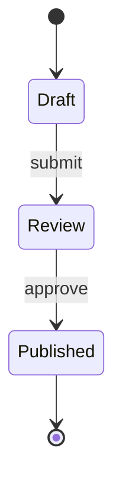

# 표와 Mermaid 확인

창 너비를 줄여도 긴 셀의 내용과 테두리를 확인할 수 있습니다.

| 항목 | 설명 | 상태 | 수량 |
| :--- | :--- | :---: | ---: |
| 한국어 | 긴 문장은 셀 안에서 줄바꿈됩니다. 오른쪽으로 이동하지 않아도 마지막 글자까지 읽을 수 있습니다. | 확인 | 120 |
| English | Long descriptions wrap at word boundaries and stay inside the table borders. | Ready | 3 |
| 링크 | [표와 다이어그램의 지원 범위](../docs/mermaid.md) 두 번째 줄도 같은 셀입니다. | 완료 | 42 |

## Entity relationship

## Class

## State

